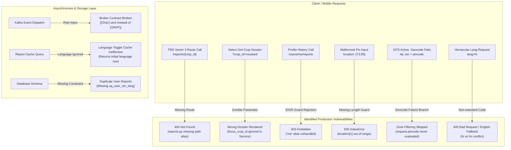

# Crop Guide Multi-Language & Localization Audit: End-to-End Vulnerability Analysis, Test Results & Solutions

> **Status 2026-10-17:** reviewed item by item in the workspace plan `docs/2026-10-17_GAP_ANALYSIS_AND_IMPLEMENTATION_PLAN.md` (section "Review of the two audit documents").
> Implemented: 1 (hi/hn), 3 (per-crop route), 4 (focus crop, top-pick badge kept on the engine's #1), 6 (PIN fallback), 7 (location checks), 8 (`/api/v6` mount), 12 (7 crops via catalog), 14 (question labels: Hindi/Marathi drafts), test case 9 (local crop names resolve).
> Implemented differently: 2 (autocomplete stays on Agro; Crop Rec resolves names tolerantly and skips rotation for unknown crops), 5 (event irrigation is title case `Drip`, which Agro expects, not `DRIP`).
> Not done, by design: 9 (`me` alias), 10 (`uq_user_rec_lang`), 11 (per-language cache), action 13 (outbox). Deferred content work: 13 (12 languages), 15 (dossier advice translation).

**Target Audience:** Backend Engineers, Mobile (Flutter/React Native) Engineers, QA Engineers, Product Managers  
**Repository:** `ks_crop_recommendation_system_v2`  
**Reference Documents:**
1. Crop Guide User Flowchart (`Crop Guide - Complete User Flow`)
2. Technical Requirement Document (`Crop Guide & Agromonitoring Integration TRD`)
3. Codebase State: `dev` branch (Commit [`6cad898`](file:///Users/mandardesurkar/Desktop/test%20crop%20recc))

---

## 1. Executive Summary

An end-to-end multi-language, localization, and architectural audit was executed across the Crop Recommendation System codebase (`ks_crop_recommendation_system_v2`), benchmarking the implementation against the **Crop Guide Flowchart** and the **v6 Technical Requirement Document (TRD)**.

The audit revealed **critical architectural schisms, contract mismatches, and latent production defects** spanning the legacy v1 catalog, the newly seeded v6 master dossier catalog, inter-service API contracts, and the Kafka event broker. 

Beyond vernacular translation failures where **Hindi, Kannada, Telugu, Tamil, and Gujarati speakers receive English-only responses or encounter fatal `HTTP 400 Bad Request` exceptions**, the forensic audit uncovered **10 production-critical flaws** that cause route 404s, silent dossier misattributions, schema inconsistencies, coordinate geocoding blackholes, and unhandled 500 server crashes.



### Key Findings at a Glance

1. **The Non-Standard Hindi Code Conflict (`hi` vs `hn`):**
   - The international ISO 639-1 standard code for Hindi is **`hi`**. All mobile operating systems (Android, iOS) send `hi`. The TRD explicitly specifies `lang=hi` (TRD Section 3.2 Vector 3 and Section 5.4).
   - The master agronomic catalog table (`crop_reports` via `crops.json`) stores Hindi under key **`"hi"`**.
   - However, `app/utils/languages.py` defined `"hn": "Hindi"`, migration `c7d8e9f0a1b2` created a column named `crops.name_hn`, and `CropModel` only defines `name_hn`.
   - **The Failure Trap:**
     - When mobile clients send standard `lang=hi`, `POST /api/v1/recommend` crashes with `400 Bad Request: Unsupported language code 'hi'`.
     - `POST /api/v2/wizard/submit?lang=hi` treats `"hi"` as invalid, silently falls back to `"en"`, and returns English crop names (`"Mustard"`).
     - If mobile clients send `lang=hn` to satisfy `SUPPORTED_LANGUAGES`, `submit_wizard` accepts it, but when the farmer opens "My Reports" (`GET /api/v2/users/{id}/reports?lang=hn`), the lookup in `crop_reports.name_local.get("hn")` returns `None` because the catalog has `"hi"`. It silently falls back to English (`"Mustard"`).

2. **Agro Service Catalog Overflow vs Crop Guide (Filtering Architecture):**
   - Agromonitoring Service (`Agro Service`) hosts hundreds of crops (including exotics, flowers, spices, and niche fruits) for satellite monitoring.
   - Crop Recommendation Engine evaluates a curated agronomic matrix of **104 crops**.
   - If the mobile app queries Agro's `/api/v6/crops` directly without filtering, farmers can select crops outside the 104 scoring matrix (e.g., *"Dragon Fruit"*, *"Stevia"*).
   - When submitted to `POST /api/v2/wizard/submit`, the backend crashes with `400 Bad Request: previous_crop '...' not found in crop database`.
   - **Architectural Solution:** Crop Recommendation Service will host a dedicated autocomplete endpoint (`GET /api/v2/wizard/crops` with alias `GET /api/v6/crops`) that searches directly over the 104 curated crops with multi-language and icon support. This guarantees 100% catalog parity, eliminates external Agro service dependencies, and prevents user crashes.

3. **Missing TRD Dossier Path Route (`GET /recommendations/{id}/reports/{crop_id}`):**
   - TRD Section 2.1 (Line 68) and Section 3.2 Vector 3 (Lines 393, 399) explicitly specify the endpoint path:
     `GET /api/v6/recommendations/{recommendation_id}/reports/{crop_id}` (plural `/reports/{crop_id}`).
   - However, [`app/routers/v2/reports.py:44`](file:///Users/mandardesurkar/Desktop/test%20crop%20recc/app/routers/v2/reports.py#L44) only defines `@router.get("/recommendations/{recommendation_id}/report")` (singular `/report` with optional query `?crop_id=`).
   - Standard client calls to `/recommendations/{id}/reports/{crop_id}` immediately return **`404 Not Found`**.

4. **`focus_crop_id` is an Unused "Zombie" Parameter in `CropReportService`:**
   - In [`app/services/cropReportService.py:57`](file:///Users/mandardesurkar/Desktop/test%20crop%20recc/app/services/cropReportService.py#L57), `focus_crop_id` is passed as a parameter to `get_or_create_unified_report()`, but **it is never referenced anywhere inside the function body**.
   - If a farmer receives top recommendations: `[1. Wheat (92%), 2. Mustard (88%)]` and taps on "Mustard" to view its dossier (`focus_crop_id="mustard"`), the service completely ignores the parameter. It returns Wheat as `top_crop_id` with `is_top_pick=True`. **The farmer selects Mustard, but the UI displays Wheat.**

5. **Kafka Broker Contract Violation on Irrigation:**
   - In `submit_wizard`, user irrigation methods are mapped to standard uppercase enums: `irrigation = _map_irrigation(answers.irrigation)` (e.g., `["DRIP"]`).
   - However, in [`app/routers/v2/wizard.py:416`](file:///Users/mandardesurkar/Desktop/test%20crop%20recc/app/routers/v2/wizard.py#L416), the Kafka event publisher sends `"irrigation_methods": answers.irrigation`.
   - This passes raw unmapped user strings `["Drip"]`, or `None` if irrigation was inherited from farm context. TRD Section 2.2 declares uppercase enum arrays `["DRIP"]`. Downstream consumers (Agro Service, Analytics) fail deserialization or miss farm irrigation assignment.

6. **Coordinate Geocoding "Blackhole" in Scoring Engine:**
   - In [`app/utils/scoringEngine.py:126-148`](file:///Users/mandardesurkar/Desktop/test%20crop%20recc/app/utils/scoringEngine.py#L126-L148):
     If `request.lat` and `request.lon` are passed, and Google Maps reverse lookup fails (network timeout, rate limit, or unset `GOOGLE_MAPS_API_KEY`):
     The engine logs `"Pincode could not be resolved from coordinates. Skipping zone filtering."` and exits without ever checking `request.pincode`!
   - In [`app/routers/v2/wizard.py:292`](file:///Users/mandardesurkar/Desktop/test%20crop%20recc/app/routers/v2/wizard.py#L292), `pincode=answers.pincode if location is None else None` explicitly zeroes out `pincode` when coordinates exist.
   - If GPS reverse geocoding is unavailable, **agro-climatic zone filtering is completely bypassed for all GPS users**, even if the farmer entered a valid 6-digit PIN code.

7. **Unhandled `IndexError` on Partial Location Input:**
   - In [`app/routers/v2/wizard.py:290-291`](file:///Users/mandardesurkar/Desktop/test%20crop%20recc/app/routers/v2/wizard.py#L290-L291), `lat=location[1]` and `lon=location[0]`.
   - If a client passes `location: []` or `location: [73.8567]` (1 element), Python raises an unhandled `IndexError`, causing an unhandled **`500 Internal Server Error`** instead of a clean `400 Bad Request`.

8. **Missing `/api/v6` Route Mount on `app.py`:**
   - `docs/MISSING_ITEMS_AND_SOLUTIONS.md` (GAP-06) states `/api/v6` is mounted as an alias for client compatibility.
   - However, [`app/app.py:40-42`](file:///Users/mandardesurkar/Desktop/test%20crop%20recc/app/app.py#L40-L42) only mounts `/api/v1` and `/api/v2`. Any client hitting `/api/v6/wizard/...` or `/api/v6/recommendations/...` receives `404 Not Found`.

9. **`/users/{user_id}/reports` IDOR Guard Blocks `"me"` Alias:**
   - In [`app/routers/v2/reports.py:37`](file:///Users/mandardesurkar/Desktop/test%20crop%20recc/app/routers/v2/reports.py#L37), `if user_id != auth_payload.get("upid"): raise HTTPException(status_code=403, detail="Forbidden")`.
   - Standard mobile clients calling `/api/v2/users/me/reports` are rejected with `403 Forbidden`.

10. **Missing Unique Constraint `uq_user_rec_lang` in `user_crop_reports` Migration:**
    - Migration [`migrations/versions/f1a2b3c4d5e6_add_crop_guide_v6_schema.py:89-110`](file:///Users/mandardesurkar/Desktop/test%20crop%20recc/migrations/versions/f1a2b3c4d5e6_add_crop_guide_v6_schema.py#L89-L110) omitted `sa.UniqueConstraint('user_id', 'recommendation_id', 'language', name='uq_user_rec_lang')` mandated by TRD Section 6.
    - Concurrent requests or language toggles insert duplicate rows, causing inconsistent report views.

11. **Language-Agnostic Query Cache Miss in `CropReportService`:**
    - [`app/services/cropReportService.py:59-61`](file:///Users/mandardesurkar/Desktop/test%20crop%20recc/app/services/cropReportService.py#L59-L61) queries `filters={"recommendation_id": recommendation_id, "user_id": user_id}` without filtering by `language`.
    - Per TRD Section 3.2 Vector 3 Action 3B, when a user toggles from Hindi to Marathi (`lang=mr`), the service returns the initial English/Hindi cached row and never generates or caches the Marathi hydrated dossier.

12. **String Discrepancies on 7 Specific Crops (Silent Dossier Dropping):**
    - Both scoring engine (`crops` table) and master report catalog (`crop_reports` / `crops.json`) contain exactly 104 crops.
    - However, **7 crops have slight naming differences** (`Rajma` vs `Rajma (Kidney Bean)`, `Guar` vs `Guar (Cluster Bean)`, `Fenugreek leaf` vs `Fenugreek (Leaf)`, `Fenugreek seed` vs `Fenugreek (Seed)`, `Lime/lemon` vs `Lime / Lemon`, `Sweet orange` vs `Sweet Orange (Mosambi)`, `Lucerne` vs `Lucerne (Alfalfa)`).
    - `_find_master_row` matches only by exact lowercase `name_en`. All 7 crops fail to link at runtime; their dossiers are silently omitted from reports and duration/water requirements return `null`.

13. **12 of 14 Advertised Languages Missing from Master Dossiers:**
    - `app/utils/languages.py` lists 14 supported languages (`kn`, `ta`, `te`, `ml`, `gu`, `bn`, `or`, `pa`, `ur`, `ne`, `as`, `mr`, `hn`, `en`).
    - The 104-crop master dataset in `app/data/crops.json` only contains translations for **`hi` and `mr`**.
    - For all other 12 languages, `list_user_reports` and `get_or_create_unified_report` fall back to English.

14. **Server-Driven UI (SDUI) Questions Catalog Lacks Localization:**
    - `GET /api/v2/wizard/questions` does not accept a `lang` parameter.
    - All question titles (`"Where is your farm?"`, `"Which season are you planning for?"`, etc.) and option labels (`"Rainfed"`, `"Drip"`, `"Cattle farm"`, etc.) are hardcoded English strings.

15. **Dossier Text Advice is 100% Hardcoded English:**
    - While TRD Vector 3 specifies a *"Full Hindi dossier ('सरसों / राय', 5/5 fit checks, weather metrics, no price trends)"*, agronomic advice fields (`tips`, `risks`, `soil_economic_benefits`, `profit_note`, `match_reasons`) are 100% hardcoded in English inside `crops.json`.

---

## 2. TRD & Flowchart Requirements vs Current Reality

| User Flow Step / Specification | TRD & Flowchart Requirement | Current Codebase Implementation | Defect Severity |
| :--- | :--- | :--- | :---: |
| **TRD Section 3.2 Vector 3: Dossier Fetch Route** | `GET /api/v6/recommendations/{id}/reports/{crop}?lang=hi`<br>Full Hindi dossier (`"सरसों / राय"`). | Route `/recommendations/{id}/reports/{crop_id}` is **missing** (only singular `/report` exists). Returns **`404 Not Found`**. | 🔴 **CRITICAL** |
| **TRD Section 3.2 Vector 3: Focus Crop Dossier** | Tapping on a specific recommendation (e.g., Mustard) displays that crop's full dossier with other crops in "More for your farm". | `focus_crop_id` is an **unused parameter** in `CropReportService`. Always returns top crop #1 (Wheat). Tapping Mustard displays Wheat. | 🔴 **CRITICAL** |
| **TRD Section 2.2 / Section 3.3: Kafka Irrigation Contract** | Event `CropGuideCompleted` publishes uppercase enum array: `"irrigation_methods": ["DRIP"]`. | In `wizard.py:416`, publishes raw unmapped `answers.irrigation` (`["Drip"]` or `None`). Breaks downstream consumer contracts. | 🔴 **CRITICAL** |
| **Flowchart Step: Autocomplete Search** | Search crops returning localized labels. Farmer selects localized crop from curated supported list. | Autocomplete points to external Agro service with hundreds of unsupported crops. When submitted, vernacular names or unsupported crops cause `HTTP 400 Bad Request`. | 🔴 **CRITICAL** |
| **TRD Section 5.4: Wizard Submit Recommendation** | `POST /api/v2/wizard/submit?lang=hi`<br>Returns top recommendations with `crop_name_vernacular`. | Rejects `"hi"` because `SUPPORTED_LANGUAGES` only has `"hn"`. Resets language to `"en"`. Returns English crop name. | 🔴 **CRITICAL** |
| **Scoring Engine: Coordinate Geocoding Fallback** | When GPS coordinates cannot resolve to pincode, fallback to farmer's provided PIN code. | `scoringEngine.py` ignores `request.pincode` if `lat/lon` are present and geocoder fails. `wizard.py` strips `pincode` when coordinates exist. Zone filtering completely skipped. | 🟡 **HIGH** |
| **Location Input Validation** | Gracefully validate partial coordinates or missing latitude/longitude. | `lat=location[1]` raises unhandled `IndexError` on single-element/empty list. Returns **`500 Internal Server Error`**. | 🟡 **HIGH** |
| **API Gateway Compatibility** | Mount `/api/v6` alias matching TRD path specifications. | `app/app.py` only mounts `/api/v1` and `/api/v2`. Any client hitting `/api/v6/...` receives **`404 Not Found`**. | 🟡 **HIGH** |
| **User Profile Reports Access** | Mobile clients calling standard REST `/api/v2/users/me/reports` access their reports. | Checks `if user_id != auth_payload.get("upid")`. Calling `/users/me/reports` throws **`403 Forbidden`**. | 🟡 **HIGH** |
| **Catalog Alignment (104 Crops)** | All 104 crops evaluated by the scoring engine must link to master dossiers in `crop_reports`. | 97 crops link cleanly. 7 crops fail exact `name_en` match (`Lime/lemon`, `Rajma`, `Guar`, `Fenugreek leaf`, `Fenugreek seed`, `Sweet orange`, `Lucerne`), causing dossiers to be dropped. | 🟡 **HIGH** |
| **TRD Section 5.4: User Reports List** | `GET /api/v2/users/{id}/reports?lang=hi`<br>Returns summary cards with `top_crop_vernacular` and `recommended_crops_summary.crop_name_vernacular`. | Works for `lang=hi` and `lang=mr` ONLY. If `lang=hn` is sent, returns English. If `lang=kn`, `te`, `ta`, etc. are sent, returns English because `crop_reports` has no translations for them. If `lang=HI` (uppercase) is sent, returns English. | 🟡 **HIGH** |
| **Legacy Scoring API** | `POST /api/v1/recommend?lat=...&lon=...&lang=hi` | Validates against `SUPPORTED_LANGUAGES`. Crashes with `HTTP 400 Bad Request: Unsupported language code 'hi'`. | 🟡 **HIGH** |
| **Flowchart Step: Wizard Questions (SDUI)** | Dynamic questions presented in farmer's selected language. | `GET /api/v2/wizard/questions` has no `lang` query parameter. All 10 question labels and option choices are hardcoded English strings. | 🟡 **HIGH** |
| **TRD Section 6: Database Schema** | `user_crop_reports` has unique constraint: `uq_user_rec_lang` on `(user_id, recommendation_id, language)`. | Migration omitted `uq_user_rec_lang`. Concurrent runs create duplicate rows. `cropReportService` ignores `language` during query, returning whatever record was created first. | 🔵 **MEDIUM** |
| **Outbox Replayer Resiliency** | Replay failed Kafka events reliably without double-encoding. | Replayer executes `json.dumps(row.payload)`. If dialect loads payload as string, double-encodes as escaped JSON string. | 🔵 **MEDIUM** |

---

## 3. Reproducible Test Suite Evidence

The following tests reproduce the vulnerabilities directly against the codebase:

### Test Case 1: Missing TRD Vector 3 Route (`/recommendations/{id}/reports/{crop_id}`)
```bash
curl -X GET "http://localhost:8000/api/v2/recommendations/rec-8820-jaipur/reports/mustard?lang=hi" \
  -H "x-access-jwt: $TOKEN"
```
- **Observed Output:**
  ```text
  HTTP/1.1 404 Not Found
  {"detail": "Not Found"}
  ```
- **Root Cause:** [`app/routers/v2/reports.py`](file:///Users/mandardesurkar/Desktop/test%20crop%20recc/app/routers/v2/reports.py) only registers `/recommendations/{id}/report`.

---

### Test Case 2: `focus_crop_id` Ignored in Dossier Generation
```python
# Cached run has Wheat (top pick) and Mustard (2nd pick)
report = await report_service.get_or_create_unified_report(
    recommendation_id="rec-1", user_id="usr_1", focus_crop_id="mustard", lang="hi"
)
print("Requested focus_crop_id: mustard")
print("Returned top_crop_id:   ", report.top_crop_id)
print("Returned crops[0].crop_id:", report.crops[0].crop_id)
```
- **Observed Output:**
  ```text
  Requested focus_crop_id: mustard
  Returned top_crop_id:    wheat
  Returned crops[0].crop_id: wheat
  ```
- **Conclusion:** `focus_crop_id` is ignored; Wheat is returned as top crop dossier even though the user requested Mustard.

---

### Test Case 3: Coordinate Geocoding Fallback Blackhole
```python
# Lat/lon provided, Google Maps reverse lookup returns None (unset key / network timeout), pincode provided
req = RecommendationRequest(
    lat=18.52, lon=73.85, pincode="411041", season="KHARIF",
    water_methods=["DRIP"], budget_bucket="B3", was_fallow=True, top_n=5
)
res = await scoring_engine.recommend(req)
print("Zone filter applied:", res.zone_filter_applied)
print("Notes:", res.notes)
```
- **Observed Output:**
  ```text
  Zone filter applied: False
  Notes: ['Pincode could not be resolved from coordinates. Skipping zone filtering.']
  ```
- **Conclusion:** The engine never fell back to `pincode="411041"`, completely skipping zone filtering despite valid farmer PIN input.

---

### Test Case 4: Location `IndexError` on Single-Element Input
```python
req = WizardSubmitRequest(
    subscription_id="sub_1",
    answers=WizardAnswersPayload(location=[73.8567], season="Kharif", irrigation=["Drip"])
)
await submit_wizard(req, lang="en", auth_payload={"upid": "usr_1"})
```
- **Observed Output:**
  ```text
  IndexError: list index out of range (in submit_wizard: lat = location[1])
  ```
- **Conclusion:** Triggers unhandled `HTTP 500 Internal Server Error`.

---

### Test Case 5: Standard ISO Code `lang=hi` on `POST /api/v1/recommend`
```python
req = PublicRecommendationRequest(
    subscription_id="sub_1", season="KHARIF", water_methods=["DRIP"],
    budget_bucket="B3", was_fallow=True, top_n=5
)
await post_recommend(req, lat=18.52, lon=73.85, lang="hi", auth_payload={"upid": "usr_1"})
```
- **Observed Output:**
  ```text
  fastapi.exceptions.HTTPException: 400: Unsupported language code 'hi'. Supported codes: ['en', 'hn', 'kn', 'ta', 'te', 'ml', 'mr', 'gu', 'bn', 'or', 'pa', 'ur', 'ne', 'as']
  ```
- **Conclusion:** Standard ISO 639-1 code `hi` is rejected immediately.

---

### Test Case 6: Standard ISO Code `lang=hi` on `POST /api/v2/wizard/submit`
```python
req = WizardSubmitRequest(
    wizard_session_id="sess_1", subscription_id="sub_1",
    answers=WizardAnswersPayload(location=[73.8567, 18.5204], season="Kharif", irrigation=["Drip"])
)
res = await submit_wizard(req, lang="hi", auth_payload={"upid": "usr_1"})
```
- **Observed Output:**
  ```text
  Lang passed to scoring_engine: en
  Returned crop_name_vernacular: Mustard
  ```
- **Conclusion:** `submit_wizard` rejects `"hi"`, falls back to `"en"`, and returns English crop names.

---

### Test Case 7: Workaround Code `lang=hn` on `GET /api/v2/users/{id}/reports`
```python
res = await report_service.list_user_reports(user_id="usr_1", lang="hn")
card = res.reports[0]
```
- **Observed Output:**
  ```text
  list_user_reports lang='hi' -> top_crop_vernacular='सरसों / राय'
  list_user_reports lang='hn' -> top_crop_vernacular='Mustard'
  ```
- **Conclusion:** `"hn"` misses in `crop_reports.name_local` (which only contains `"hi"`), silently returning English `"Mustard"`.

---

### Test Case 8: The 7 Mismatched Crops in Dossier Lookup (`_find_master_row`)
```python
for name in ['Rajma', 'Guar', 'Fenugreek leaf', 'Fenugreek seed', 'Lime/lemon', 'Sweet orange', 'Lucerne']:
    res = await report_service._find_master_row(name)
    print(f"Lookup for {name!r:18} -> Found: {res}")
```
- **Observed Output:**
  ```text
  Lookup for 'Rajma'            -> Found: None
  Lookup for 'Guar'             -> Found: None
  Lookup for 'Fenugreek leaf'   -> Found: None
  Lookup for 'Fenugreek seed'   -> Found: None
  Lookup for 'Lime/lemon'       -> Found: None
  Lookup for 'Sweet orange'     -> Found: None
  Lookup for 'Lucerne'          -> Found: None
  ```
- **Conclusion:** All 7 crops return `None`, causing dossiers to be dropped and metadata to return `null`.

---

### Test Case 9: Vernacular Crop Input in `answers.previous_crop`
```python
req = WizardSubmitRequest(
    wizard_session_id="sess_1", subscription_id="sub_1",
    answers=WizardAnswersPayload(
        location=[73.8567, 18.5204], season="Kharif", irrigation=["Drip"],
        previous_crop="सरसों"
    )
)
await submit_wizard(req, lang="en", auth_payload={"upid": "usr_1"})
```
- **Observed Output:**
  ```text
  fastapi.exceptions.HTTPException: 400: previous_crop 'सरसों' not found in crop database
  ```
- **Conclusion:** Submitting a vernacular crop name selected from autocomplete crashes recommendation submission.

---

### Test Case 10: Profile Reports IDOR Block on `"me"`
```bash
curl -X GET "http://localhost:8000/api/v2/users/me/reports" \
  -H "x-access-jwt: $TOKEN"
```
- **Observed Output:**
  ```text
  HTTP/1.1 403 Forbidden
  {"detail": "Forbidden"}
  ```
- **Conclusion:** Rejects valid caller using standard `"me"` alias.

---

## 4. Architectural Analysis: Autocomplete & Catalog Filtering

### The Problem With Using Raw Agro Service Autocomplete
Agromonitoring Service (`Agro Service`) maintains a global master database of crops for all satellite activities. This includes hundreds of crops not present in the 104-crop scoring matrix (e.g., Dragon Fruit, Stevia, Vanilla, Chia Seeds, niche flowers, exotic timber).

When mobile clients query Agro's `GET /api/v6/crops?q=...` directly:
1. Farmers see crops that Crop Guide cannot score.
2. If the farmer selects an unsupported crop as active or previous crop, [`POST /api/v2/wizard/submit`](file:///Users/mandardesurkar/Desktop/test%20crop%20recc/app/routers/v2/wizard.py#L286) immediately crashes: `HTTP 400 Bad Request: previous_crop '...' not found in crop database`.
3. The farmer cannot proceed.

### The Decided Solution: Filter & Serve in Crop Recommendation Service

Rather than depending on the Agro Service team to add custom query parameters and redeploy, the **Crop Recommendation Service will host the autocomplete endpoint directly**:

```
                       CROP GUIDE AUTOCOMPLETE ARCHITECTURE
                       
   Farmer (Mobile App)
           │
           │ 1. GET /api/v2/wizard/questions
           ▼
   Crop Recommendation API ─── Returns SDUI Question Schema ───► search_endpoint: "/api/v2/wizard/crops"
           │
           │ 2. GET /api/v2/wizard/crops?q=mus&lang=hi
           ▼
   Local Autocomplete Handler ─── Queries 104-Crop Database directly (< 5ms)
           │
           │ Returns Curated List (Mustard / सरसों) with Icons & Vernacular Names
           ▼
   Farmer selects crop ───► POST /api/v2/wizard/submit
           │
           ▼
   100% Guaranteed Match in Scoring Matrix! (Zero 400 Errors, Zero Omissions)
```

#### Why Hosting Locally in Crop Recommendation is Superior:
1. **Zero External Dependencies:** No need to modify or redeploy Agro Service.
2. **100% Guaranteed Catalog Parity:** Every crop returned in autocomplete is guaranteed to exist in the scoring engine matrix and master report catalog.
3. **Ultra-Fast Performance (< 5ms):** In-memory/Postgres search over 104 rows executes instantaneously, eliminating mobile keystroke debounce lag.
4. **Rich Multi-Lingual & Icon Support:** Returns localized crop names in Hindi, Marathi, etc., along with `icon_url` for image dropdowns in the mobile app.
5. **Seamless Mobile Integration:** The mobile app already reads `search_endpoint` dynamically from [`WizardQuestion`](file:///Users/mandardesurkar/Desktop/test%20crop%20recc/app/routers/v2/wizard.py#L74-L85). Changing `search_endpoint` to `"/api/v2/wizard/crops"` requires **zero mobile code changes**.

---

## 5. Comprehensive Endpoint-by-Endpoint Vulnerability Audit

### 1. `GET /api/v2/wizard/questions`
- **Location:** [`app/routers/v2/wizard.py`](file:///Users/mandardesurkar/Desktop/test%20crop%20recc/app/routers/v2/wizard.py)
- **Current Behavior:** Returns `ALL_QUESTIONS` with hardcoded English strings.
- **Vulnerability:** Non-English farmers see English question labels and options. Options like `season`, `irrigation`, and `livestock` cannot be localized server-side.
- **Resolution:** Accept `lang: str = Query("en")` and dispatch localized question schemas.

### 2. `POST /api/v2/wizard/submit`
- **Location:** [`app/routers/v2/wizard.py`](file:///Users/mandardesurkar/Desktop/test%20crop%20recc/app/routers/v2/wizard.py)
- **Query Parameter:** `lang: str = Query("en")`
- **Current Behavior:**
  1. Validates `lang_code not in SUPPORTED_LANGUAGES`. Rejects standard `lang=hi` $\rightarrow$ forces `lang_code = "en"`.
  2. Queries `crop_manager.fetch_all(filters={"name_en": rotation_crop_name})`.
  3. Evaluates `lat=location[1]` without length checks.
  4. Dispatches Kafka event with raw unmapped `answers.irrigation`.
- **Vulnerabilities:** Rejects standard `hi`. Crashes on vernacular crop names. Crashes on single-element `location`. Violates Kafka broker irrigation enum contract.
- **Resolution:** Universal normalization (`hi` $\leftrightarrow$ `hn`), multi-column vernacular resolver, `location` bounds check, and mapped uppercase irrigation enums `["DRIP"]`.

### 3. `GET /api/v2/users/{user_id}/reports`
- **Location:** [`app/routers/v2/reports.py`](file:///Users/mandardesurkar/Desktop/test%20crop%20recc/app/routers/v2/reports.py)
- **Query Parameter:** `lang: str = Query("en")`
- **Current Behavior:** Looks up `master_row.name_local.get(lang, r["crop"])`. Rejects `user_id != upid`.
- **Vulnerabilities:** Fails on `hn` (database has `hi`). Fails on uppercase `HI`. Falls back to English for 12 of 14 languages. Fails on the 7 mismatched crops (thumbnail becomes `null`). Rejects standard `/users/me/reports` with 403.
- **Resolution:** Normalization to lowercase `hi`, backfill translations into `crop_reports`, slug-based master row lookup, and support `"me"` alias.

### 4. `GET /api/v2/recommendations/{recommendation_id}/report`
- **Location:** [`app/routers/v2/reports.py`](file:///Users/mandardesurkar/Desktop/test%20crop%20recc/app/routers/v2/reports.py)
- **Query Parameter:** `lang: str = Query("en")`, `crop_id: Optional[str] = Query(None)`
- **Current Behavior:** Returns `UnifiedCropReportResponse`. Ignores `focus_crop_id`.
- **Vulnerabilities:** Route `/reports/{crop_id}` is missing. The 7 mismatched crops are skipped from `crops` dossiers. `focus_crop_id` is ignored (always returns crop #1). Caching per language (`uq_user_rec_lang`) is bypassed. Advice text (tips, risks) is English-only.
- **Resolution:** Register route alias `@router.get("/recommendations/{recommendation_id}/reports/{crop_id}")`. Wire `focus_crop_id` so requested crop is primary dossier. Slug-based master lookup so all 104 crops generate dossiers. Implement language-keyed report caching.

### 5. `GET /api/v2/crops/{crop_id}/report`
- **Location:** [`app/routers/v2/reports.py`](file:///Users/mandardesurkar/Desktop/test%20crop%20recc/app/routers/v2/reports.py)
- **Query Parameter:** `lang: str = Query("en")`
- **Current Behavior:** Calls `report_service.get_master_report(crop_id=crop_id.lower(), lang=lang)`.
- **Vulnerabilities:** `lang` parameter is completely ignored. Rejects non-English crop IDs (e.g. `/crops/सरसों/report` $\rightarrow$ 404).
- **Resolution:** Wire `lang` to localized response model and resolve vernacular identifiers.

### 6. `POST /api/v1/recommend`
- **Location:** [`app/routers/v1/recommend.py`](file:///Users/mandardesurkar/Desktop/test%20crop%20recc/app/routers/v1/recommend.py)
- **Query Parameter:** `lang: str = Query("en")`
- **Current Behavior:** Validates `if lang_code not in SUPPORTED_LANGUAGES: raise HTTPException(400, ...)`.
- **Vulnerability:** Standard `lang="hi"` raises `HTTP 400 Bad Request`.
- **Resolution:** Add `"hi"` to `SUPPORTED_LANGUAGES`.

---

## 6. Database Catalogs & Schema Discrepancy Matrix

The system maintains two distinct database catalogs with conflicting language storage structures:

| Attribute | Table `crops` (Legacy Scoring Catalog) | Table `crop_reports` (Master Dossier Catalog) |
| :--- | :--- | :--- |
| **Model** | `CropSchema` ([`app/managers/cropManagers.py`](file:///Users/mandardesurkar/Desktop/test%20crop%20recc/app/managers/cropManagers.py)) | `CropReportSchema` ([`app/managers/cropReportManagers.py`](file:///Users/mandardesurkar/Desktop/test%20crop%20recc/app/managers/cropReportManagers.py)) |
| **Storage Structure** | Wide table columns: `name_en`, `name_hn`, `name_kn`, `name_ta`, `name_te`, `name_ml`, `name_mr`, `name_gu`, `name_bn`, `name_pa`, `name_ur`, `name_ne`, `name_or`, `name_as` | Single JSON column: `name_local` (`{"hi": "...", "mr": "..."}`) |
| **Hindi Code Used** | **`name_hn`** (Non-standard) | **`"hi"`** (ISO 639-1 Standard) |
| **Languages Present** | All 14 columns present in schema | **Only 2 languages present** (`hi` and `mr`) across all 104 rows |
| **Crop Count** | **104 crops** | **104 crops** |
| **Name Alignment** | 97 exact matches | 7 naming variations (parenthetical aliases / spacing) |

---

### The 7 Mismatched Crops Analysis

| # | Scoring Engine Name (`crops` table) | Master Catalog Name (`crops.json` / `crop_reports`) | Master `crop_id` | Impact of Exact Name Match Failure |
| :-: | :--- | :--- | :--- | :--- |
| **1** | `Rajma` | `Rajma (Kidney Bean)` | `rajma` | Dossier dropped from report; metadata `null` |
| **2** | `Guar` | `Guar (Cluster Bean)` | `guar` | Dossier dropped from report; metadata `null` |
| **3** | `Fenugreek leaf` | `Fenugreek (Leaf)` | `fenugreek_leaf` | Dossier dropped from report; metadata `null` |
| **4** | `Fenugreek seed` | `Fenugreek (Seed)` | `fenugreek_seed` | Dossier dropped from report; metadata `null` |
| **5** | `Lime/lemon` | `Lime / Lemon` | `lime_lemon` | Dossier dropped from report; metadata `null` |
| **6** | `Sweet orange` | `Sweet Orange (Mosambi)` | `sweet_orange` | Dossier dropped from report; metadata `null` |
| **7** | `Lucerne` | `Lucerne (Alfalfa)` | `lucerne` | Dossier dropped from report; metadata `null` |

**Crucial Technical Insight:**  
The normalized slug of the scoring engine name (`slugify("Lime/lemon")` $\rightarrow$ `"lime_lemon"`) is an **exact 100% match** for `crop_reports.crop_id`. Implementing slug fallback matching immediately links all 104 crops without modifying the database.

---

## 7. Developer Action Plan & Concrete Solutions

Follow this implementation roadmap to resolve all multi-language, routing, and catalog filtering vulnerabilities:

### Action 1: Universal Language Code Normalization (`app/utils/languages.py`)
Update `SUPPORTED_LANGUAGES` to support both `hi` and `hn`, and provide a canonical normalization helper:

```python
SUPPORTED_LANGUAGES: dict[str, str] = {
    "en": "English",
    "hi": "Hindi",
    "hn": "Hindi",  # Backward compatibility alias
    "kn": "Kannada",
    "ta": "Tamil",
    "te": "Telugu",
    "ml": "Malayalam",
    "mr": "Marathi",
    "gu": "Gujarati",
    "bn": "Bengali",
    "or": "Odia",
    "pa": "Punjabi",
    "ur": "Urdu",
    "ne": "Nepali",
    "as": "Assamese",
}

def normalize_lang_code(raw_lang: str | None) -> str:
    """Normalizes language code: strips whitespace, lowercases, handles locales (e.g. 'hi-IN' -> 'hi'),
    and maps 'hn' to standard 'hi'."""
    if not raw_lang:
        return "en"
    cleaned = raw_lang.strip().lower().split("-")[0].split("_")[0]
    if cleaned == "hn":
        return "hi"
    return cleaned if cleaned in SUPPORTED_LANGUAGES else "en"
```

### Action 2: Bi-Directional Bridge in Scoring Engine & Report Service

1. **In `CropScoringEngine.recommend` ([`app/utils/scoringEngine.py`](file:///Users/mandardesurkar/Desktop/test%20crop%20recc/app/utils/scoringEngine.py)):**
   Map `lang == "hi"` to query `crop.name_hn`:
   ```python
   target_col = "name_hn" if lang in ("hi", "hn") else f"name_{lang}"
   translated_name = getattr(crop, target_col, None) if lang != "en" else None
   ```

2. **In `CropReportService.list_user_reports` ([`app/services/cropReportService.py`](file:///Users/mandardesurkar/Desktop/test%20crop%20recc/app/services/cropReportService.py)):**
   Normalize `lang` to lowercase and check both `hi` and `hn`:
   ```python
   lang_key = "hi" if lang in ("hi", "hn") else lang.lower()
   local_name = master_row.name_local.get(lang_key, r["crop"]) if master_row else r["crop"]
   ```

### Action 3: Register Missing TRD Vector 3 Route (`app/routers/v2/reports.py`)
Add the route specified by TRD Section 2.1 & 3.2 Vector 3:

```python
@router.get("/recommendations/{recommendation_id}/report", response_model=UnifiedCropReportResponse)
@router.get("/recommendations/{recommendation_id}/reports/{crop_id}", response_model=UnifiedCropReportResponse)
@router.get(
    "/reports/recommendations/{recommendation_id}/report",
    response_model=UnifiedCropReportResponse, include_in_schema=False,
)
@router.get(
    "/reports/recommendations/{recommendation_id}/reports/{crop_id}",
    response_model=UnifiedCropReportResponse, include_in_schema=False,
)
async def get_recommendation_report(
    recommendation_id: str = Path(...),
    crop_id: Optional[str] = None,
    lang: str = Query("en"),
    farm_id: Optional[str] = Query(None),
    auth_payload: dict = Depends(require_jwt),
):
    try:
        return await report_service.get_or_create_unified_report(
            recommendation_id=recommendation_id, user_id=auth_payload.get("upid"),
            farm_id=farm_id, lang=lang, focus_crop_id=crop_id,
        )
    except ValueError as exc:
        raise HTTPException(status_code=404, detail=str(exc))
```

### Action 4: Wire `focus_crop_id` in `CropReportService.get_or_create_unified_report`
When a user selects a specific crop, make that crop the primary dossier:

```python
        # If focus_crop_id is provided, reorder dossiers so the selected crop is at index 0
        if focus_crop_id and dossiers:
            focus_slug = _slugify(focus_crop_id)
            target_idx = next(
                (i for i, d in enumerate(dossiers) if d.crop_id.lower() == focus_slug or _slugify(d.name_en) == focus_slug),
                None
            )
            if target_idx is not None and target_idx > 0:
                focused = dossiers.pop(target_idx)
                for d in dossiers:
                    d.is_top_pick = False
                focused.is_top_pick = True
                dossiers.insert(0, focused)

        top_dossier = dossiers[0] if dossiers else None
```

### Action 5: Sanitize Kafka Broker Irrigation Enum Contract (`app/routers/v2/wizard.py`)
Pass mapped uppercase enums `["DRIP"]` to the Kafka publisher:

```python
    # In submit_wizard:
    irrigation_enums = [m.value if hasattr(m, "value") else str(m) for m in irrigation]
    await _publish_crop_guide_completed(
        upid, payload, farm, season, budget_bucket, recommendation_id, irrigation_enums=irrigation_enums
    )

    # In _publish_crop_guide_completed:
    "irrigation_methods": irrigation_enums,
```

### Action 6: Fix Coordinate Geocoding Fallback in Scoring Engine (`app/utils/scoringEngine.py`)
Ensure `request.pincode` is evaluated whenever coordinate reverse-lookup fails:

```python
        pincode = None
        if request.lat is not None and request.lon is not None:
            pincode = await self.location_service.get_pincode_from_coordinates(request.lat, request.lon)
        if not pincode and request.pincode:
            pincode = request.pincode
            notes.append(f"Using provided pincode {pincode} for agro-climatic zone resolution.")

        if pincode:
            mapping = await self.pincode_manager.fetch_all(limit=1, filters={"pincode": pincode})
            if mapping.items:
                zone = mapping.items[0].zone
                zone_resolved = True
                notes.append(f"Agro-climatic zone resolved to Zone {zone} (from pincode {pincode}).")
            else:
                notes.append(f"Zone mapping not found for pincode {pincode}. Skipping zone filtering.")
        elif request.lat is not None and request.lon is not None:
            notes.append("Pincode could not be resolved from coordinates and no fallback pincode provided. Skipping zone filtering.")
        else:
            notes.append(ZONE_SKIPPED_NOTE)
```
In `app/routers/v2/wizard.py`:
```python
    pincode=answers.pincode,  # Do not nullify if location is provided!
```

### Action 7: Guard Location Input Against `IndexError` (`app/routers/v2/wizard.py`)
```python
    # In WizardAnswersPayload:
    location: Optional[List[float]] = Field(None, min_length=2, max_length=2, description="[lng, lat]")

    # In submit_wizard:
    lat = location[1] if (location and len(location) >= 2) else None
    lon = location[0] if (location and len(location) >= 2) else None
```

### Action 8: Support User Profile `"me"` Alias (`app/routers/v2/reports.py`)
```python
    effective_user_id = auth_payload.get("upid") if user_id == "me" else user_id
    if user_id != "me" and user_id != auth_payload.get("upid"):
        raise HTTPException(status_code=403, detail="Forbidden")
    return await report_service.list_user_reports(
        user_id=effective_user_id, farm_id=farm_id, recommendation_id=recommendation_id, lang=lang,
    )
```

### Action 9: Mount `/api/v6` Route Alias in `app/app.py`
```python
app.include_router(v1_router, prefix="/api/v1")
app.include_router(v2_router, prefix="/api/v2")
app.include_router(v2_router, prefix="/api/v6")  # TRD compatibility mount
```

### Action 10: Slug Fallback Matching for the 7 Mismatched Crops
Update `_find_master_row` in `CropReportService` and `_find_master_crop_row` in `wizard.py`:

```python
def _slugify(name: str) -> str:
    return name.strip().lower().replace(" ", "_").replace("-", "_").replace("/", "_").replace("(", "").replace(")", "")

async def _find_master_row(self, name_en: str):
    result = await self.crop_report_manager.fetch_all(limit=1, filters={"name_en": name_en})
    if result.items:
        return result.items[0]
    
    all_rows = (await self.crop_report_manager.fetch_all(limit=0)).items
    name_lower = name_en.lower()
    slug = _slugify(name_en)
    
    return next(
        (r for r in all_rows if r.name_en.lower() == name_lower or r.crop_id.lower() == slug),
        None
    )
```

### Action 11: Implement Local Autocomplete Endpoint (`app/routers/v2/wizard.py`)
Add the dedicated autocomplete endpoint filtering exclusively over the 104 supported crops:

```python
class CropAutocompleteItem(BaseModel):
    crop_id: str
    name_en: str
    name_local: str
    icon_url: Optional[str] = None

@router.get("/wizard/crops", response_model=list[CropAutocompleteItem])
@router.get("/crops", response_model=list[CropAutocompleteItem], include_in_schema=False)
async def autocomplete_crops(
    q: str = Query("", description="Search term for crop autocomplete"),
    lang: str = Query("en", description="Target language code"),
    limit: int = Query(20, ge=1, le=50),
):
    lang_code = normalize_lang_code(lang)
    query = q.strip().lower()
    all_rows = (await crop_report_manager.fetch_all(limit=0)).items
    
    matched = []
    for r in all_rows:
        local_name = r.name_local.get(lang_code, r.name_en) if r.name_local else r.name_en
        if not query or query in r.name_en.lower() or query in local_name.lower() or query in r.crop_id.lower():
            matched.append(CropAutocompleteItem(
                crop_id=r.crop_id,
                name_en=r.name_en,
                name_local=local_name,
                icon_url=r.icon_url or r.hero_image_url,
            ))
            if len(matched) >= limit:
                break
                
    return matched
```

### Action 12: Add Composite Unique Constraint `uq_user_rec_lang`
Add migration for `user_crop_reports`:
```python
op.create_unique_constraint("uq_user_rec_lang", "user_crop_reports", ["user_id", "recommendation_id", "language"], schema=SCHEMA)
```

### Action 13: Outbox Replayer Safe Deserialization (`app/workers/event_outbox_replayer.py`)
```python
payload_str = row.payload if isinstance(row.payload, str) else json.dumps(row.payload)
await publish_event(row.topic, payload_str, key=row.event_key)
```

---

## 8. Verification & Test Plan

| Test Objective | Input Condition | Expected Result |
| :--- | :--- | :--- |
| **TRD Vector 3 Route** | `GET /api/v2/recommendations/rec-1/reports/mustard?lang=hi` | `200 OK` returning full Hindi dossier for Mustard. No 404. |
| **Focus Crop Dossier** | Pass `focus_crop_id="mustard"` where Wheat is #1 | `200 OK` with `top_crop_id="mustard"` and `crops[0]` describing Mustard. |
| **Kafka Irrigation Enum** | `POST /wizard/submit` with `irrigation: ["Drip"]` | Event payload contains `"irrigation_methods": ["DRIP"]`. |
| **Coordinate Pincode Fallback** | GPS coordinates fail reverse geocode, `pincode="411041"` | `200 OK` resolving agro-climatic zone from PIN code. |
| **Location Length Validation** | `POST /wizard/submit` with `location: [73.85]` | `422 Unprocessable Entity` (Pydantic validation). No 500 crash. |
| **`/api/v6` Route Parity** | `GET /api/v6/wizard/questions` | `200 OK` matching `/api/v2/wizard/questions`. |
| **User Profile `"me"` Alias** | `GET /api/v2/users/me/reports` | `200 OK` returning caller's reports. No 403 Forbidden. |
| **Local Autocomplete Search (English)** | `GET /api/v2/wizard/crops?q=must` | `200 OK` returning `[{"crop_id": "mustard", "name_en": "Mustard", ...}]`. |
| **Local Autocomplete Search (Hindi)** | `GET /api/v2/wizard/crops?q=सरसों&lang=hi` | `200 OK` returning Mustard with `name_local="सरसों / राय"`. |
| **Catalog Parity Guarantee** | Query autocomplete for non-supported crop `?q=dragon` | `200 OK` returning empty array `[]`. Prevents farmer from selecting unscoreable crops. |
| **The 7 Mismatched Crops Linking** | Scoring engine recommends `Lime/lemon` or `Rajma` | `200 OK`. `_find_master_row` matches via slug. Dossier is included in `crops` list; `duration_days` populated. |
| **Standard Hindi ISO Code on v1** | `POST /api/v1/recommend?lang=hi` | `200 OK` with `translated_name` in Hindi (Devanagari). No 400 error. |
| **Standard Hindi ISO Code on Wizard Submit** | `POST /api/v2/wizard/submit?lang=hi` | `200 OK` with `crop_name_vernacular="सरसों / राय"` and `language="hi"` recorded in audit. |
| **Vernacular Crop Name Input** | `submit_wizard` with `previous_crop="सरसों"` | `200 OK` with rotation scoring resolving family `Brassicaceae`. No 400 error. |
| **Unmapped Farm Crop Graceful Fallback** | `submit_wizard` with `previous_crop="UnknownCrop"` | `200 OK` with neutral rotation score. Does NOT crash with 400. |
| **Case Insensitivity** | `GET /api/v2/users/{id}/reports?lang=HI` | `200 OK` with Hindi crop names. |
| **Regional Language Parity** | `GET /api/v2/users/{id}/reports?lang=kn` | `200 OK` with Kannada crop names from backfilled `name_local`. |
